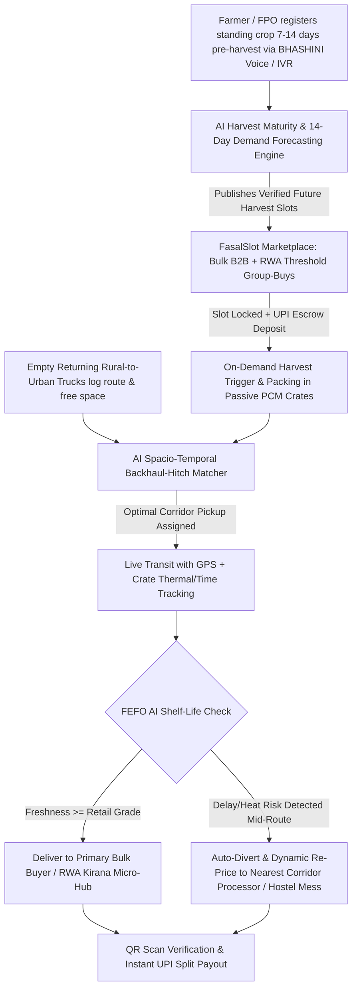

# Smart India Hackathon Workshop
# Date: 23 November 2026
## Reference Number: 26003789
## Name: Daniel S

## Problem Title
SIH 26033: Multiple intermediaries reduce farmers earnings and increase consumer prices.

## Problem Creater's Organization
Ministry of Consumer Affairs, Food & Public Distribution

## Theme
Agriculture, FoodTech & Rural Development

## Problem Description
Expected Solution: Create a digital marketplace that:

- Connects farmers/FPOs directly with consumers and bulk buyers.
- Provides logistics support.
- Uses AI for demand forecasting and route optimization.

Benefits:

- Better prices for farmers.
- Lower prices for consumers.
- Reduced supply chain inefficiencies.

**Context & Baseline Evidence:** Smallholders account for **86.1%** of Indian farm holdings with an average landholding of **1.08 hectares** ([ICRIER / OAPEN](https://library.oapen.org/bitstream/id/5b01a982-5289-4685-99c5-15a57a22a071/978-981-33-4268-2.pdf)). Because produce typically passes through 4–6 intermediary layers, a [Reserve Bank of India (RBI) study](https://www.rbi.org.in/scripts/BS_ViewBulletin.aspx?Id=18527) (cited in [Taylor & Francis](https://www.tandfonline.com/doi/abs/10.1080/17448727.2022.2082142)) found that the farmer's share in the consumer's rupee drops to **32%–68%** for horticulture and **40%–89%** for foodgrains and oilseeds. Meanwhile, fragmented cold chains and transit delays cause estimated annual post-harvest losses of **₹1.53 trillion (USD 18.5 billion)** across India ([ICRIER / NABCONS 2022](https://icrier.org/publications/reducing-post-harvest-losses-in-indian-agriculture-a-case-study-of-selected-crops/)), compounded by the fact that **94%** of India's road freight value is non-temperature-controlled ([Mordor Intelligence, 2026](https://www.mordorintelligence.com/industry-reports/india-road-freight-transport-market)).

## Proposed Solution

### 1. Detailed Explanation of the Proposed Solution
We propose **FasalSlot** — a **Pre-Harvest "Zero-Inventory Pull" Marketplace, Backhaul-Hitch Logistics Network, and FEFO Spoilage-Diversion AI** designed so crops are sold *before* they are plucked and transported inside passive-cooled crates on already-moving rural return vehicles.

Unlike conventional farm-to-fork listing apps that wait until after harvest (when spoilage and distress pricing have already begun), FasalSlot re-engineers the supply chain through four distinct mechanisms:

- **Pre-Harvest "Living-Crop" Slot Marketplace (7–14 Days Ahead):** Farmers and [Farmer Producer Organizations (FPOs)](https://www.pib.gov.in/PressReleaseDetail.aspx?PRID=2294442&reg=6&lang=1) register standing crops before maturity using a missed-call IVR or vernacular voice note powered by [Digital India BHASHINI](https://www.pib.gov.in/PressReleaseDetail.aspx?PRID=2339441&reg=17&lang=1). Bulk buyers (hostels, cloud kitchens, HoReCa, processors) and urban consumer groups reserve upcoming **Harvest Slots** in advance. Harvesting is triggered *only* when a buyer slot and pickup vehicle are locked—eliminating warehouse sitting time and distress dumping.
- **Threshold Community Micro-Drops (Consumer Group-Buy Unlock):** Instead of costly door-to-door last-mile delivery, urban consumers in an apartment complex (RWA) or street join a live neighborhood crate pool (e.g., 50 kg onions or 30 kg tomatoes). Crossing the threshold automatically unlocks a lower farm-gate price and dispatches a single consolidated crate to a verified neighborhood kirana or RWA drop-point.
- **Zero-Fleet "Backhaul-Hitch" + Passive PCM Smart Crates:** Rather than funding expensive refrigerated trucks, FasalSlot taps into India's existing road freight (which carries **66%** of total freight, per [NITI Aayog 2026](https://www.niti.gov.in/sites/default/files/2026-02/Scenarios-Towards-Viksit-Bharat-and-Net-Zero-Sectoral-Insights-Transport.pdf) / [The Secretariat](https://thesecretariat.in/article/when-india-s-rail-freight-traffic-fell-off-tracks)). Rural-bound FMCG, fertilizer, and parcel trucks frequently return to cities under-utilized or empty. FasalSlot packs graded produce into reusable **Phase-Change Material (PCM) passive-cooling crates** ([PLUSS](https://www.pluss.co.in/knowledge-center/technology/phase-change-materials/) / [Tessol](https://tessol.in/pcm-technology/))—which maintain cold temperatures via latent heat without diesel or electricity—and matches them into empty return cargo bays.
- **FEFO Shelf-Life Decay AI & Mid-Transit Cascade Diversion:** Every crate is paired with a **First-Expired-First-Out (FEFO)** biological decay model ([Royal Society / PMC](https://pmc.ncbi.nlm.nih.gov/articles/PMC4006170/); [Frontiers in Sustainable Food Systems](https://www.frontiersin.org/journals/sustainable-food-systems/articles/10.3389/fsufs.2022.1018807/pdf)) that predicts remaining marketable shelf life from harvest time, ambient heat, and live GPS traffic delays. If a shipment's predicted freshness drops below retail grade mid-route, the AI **automatically re-routes and dynamically re-prices** that crate to a closer secondary buyer (pulp/puree processor, catering kitchen, or hostel mess) along the same corridor—preventing spoilage and protecting the farmer's payout.

### 2. How It Addresses the Problem
| Core Supply Chain Problem | How FasalSlot Solves It Uniquely |
| :--- | :--- |
| **4–6 intermediary mark-ups** | Pre-harvest digital slots connect farmers/FPOs directly to bulk buyers and RWA consumer pools with zero commission agents. |
| **Post-harvest distress sales** | Selling crops 7–14 days *before* harvest removes the panic of unsold perishable stock sitting at the farm gate. |
| **High dedicated logistics & reefer cost** | Piggybacking empty rural-to-urban return trucks with passive PCM cooling crates turns ordinary non-refrigerated trucks (**94%** of India's fleet) into affordable cold-chain carriers. |
| **In-transit spoilage & waste** | Real-time FEFO shelf-life routing dynamically diverts heat- or delay-stressed crates to closer food processors before they spoil. |
| **Last-mile urban delivery costs** | Neighborhood threshold group-buys replace 30 individual doorstep trips with one RWA/kirana crate drop, passing the savings to both farmer and consumer. |

### 3. Innovation and Uniqueness of the Solution
| Common / Generic Hackathon Approach | FasalSlot's Non-Overlapping Unique Innovation |
| :--- | :--- |
| Post-harvest e-commerce listing app | **Pre-Harvest "Zero-Inventory Pull" Slot Futures** synchronized with crop maturity windows so harvesting happens strictly on confirmed demand. |
| Building a dedicated agri-fleet or standard milk-run | **Backhaul-Hitch Relay Network + Passive PCM Crates** that monetizes empty return capacity on existing non-refrigerated commercial trucks without buying reefers. |
| Static shortest-distance route optimization | **FEFO Biological Decay Routing + Automated Mid-Transit Cascade Diversion** that re-routes delay-affected perishables to nearer Tier-2 processing buyers in real time. |
| Individual home delivery model | **Neighborhood Threshold Group-Drop Gamification** where community volume automatically unlocks lower farm-gate prices at local kirana/RWA pickup points. |
| Standard smartphone-only farmer app | **Missed-Call IVR + BHASHINI Voice-Slot Registration** plus a refundable PCM crate-swap loop managed at local FPO hubs. |

## Technical Approach

### 1. Technologies to Be Used
| Layer | Technologies & Tools | Role in FasalSlot |
| :--- | :--- | :--- |
| **Farmer Access (Low-Tech)** | [BHASHINI API](https://www.pib.gov.in/PressReleaseDetail.aspx?PRID=2339441&reg=17&lang=1) (23 Indian voice languages), Toll-Free Missed-Call IVR / WhatsApp Bot | Lets low-literacy or feature-phone farmers register upcoming harvest slots and confirm crate handovers via voice. |
| **Buyer & Fleet Apps** | Next.js / React (Bulk Buyer & FPO Portal), Flutter (RWA Consumer Pool & Backhaul Driver App), Offline PWA | Enables pre-harvest slot booking, live neighborhood threshold meters, and one-tap backhaul load acceptance. |
| **Backend & Event Engine** | Python (FastAPI), Apache Kafka / Redis Streams, PostgreSQL + PostGIS, [ONDC](https://www.pib.gov.in/PressReleasePage.aspx?PRID=2204664) Beckn Protocol Adapter | Handles real-time geospatial backhaul matching, live crate telemetry events, and open-network catalog interoperability. |
| **AI Demand & Maturity Forecasting** | Temporal Fusion Transformer / LightGBM, [Agmarknet 2.0](https://agmarknet.gov.in/daily-price-and-arrival-report) Historical Prices, IMD Weather & Open Satellite NDVI (Sentinel-2) | Predicts 14-day regional crop demand, expected harvest maturity dates, and transparent fair-price bands. |
| **AI Routing & FEFO Spoilage Engine** | [Google OR-Tools](https://developers.google.com/optimization/routing/vrp) (Dynamic Pickup-Delivery & Time Windows) + Custom Q10/Arrhenius FEFO Shelf-Life Decay Model + OSRM | Matches crates to returning truck corridors and triggers automated mid-transit diversion to secondary buyers if shelf life drops below threshold. |
| **Passive Cold-Chain Hardware** | Reusable Insulated Crates with Engineered **PCM Gel Packs** ([PLUSS](https://www.pluss.co.in/knowledge-center/technology/phase-change-materials/) / [Tessol](https://tessol.in/pcm-technology/)), Low-Cost NFC/QR Tag + Optional BLE Temp Logger | Delivers electricity-free cooling inside standard trucks across 1,000–3,000 thermal cycles with tamper-proof batch traceability. |
| **Payments & Trust** | UPI Smart Escrow Split, QR Handover Verification | Locks buyer slot deposits and auto-splits instant payouts to Farmer/FPO, Backhaul Driver, and Kirana Micro-Hub upon QR scan. |

### 2. Methodology and Process for Implementation &lt;b&gt;(Flow Charts/Images/ working prototype)&lt;/b&gt;

#### End-to-End System Flow Chart (Pre-Harvest Lock → Backhaul Hitch → FEFO Auto-Diversion)

#### Implementation Methodology & 36-Hour SIH Working Prototype Plan
1. **Stage 1 — 36-Hour SIH Working Prototype (Live Demo Scope):**
   - **Pre-Harvest Slot & RWA Pool UI:** Interactive web prototype where an FPO registers a 10-day-ahead tomato/onion harvest slot and consumers join a live threshold progress bar that dynamically lowers the per-kg price as orders cross the crate target.
   - **AI Demand Forecasting Module:** Trained LightGBM/Prophet model on historical [Agmarknet](https://agmarknet.gov.in/daily-price-and-arrival-report) arrival/price series outputting 14-day regional demand and fair-price bands.
   - **Backhaul-Hitch & FEFO Diversion Simulator:** Live map simulation using [Google OR-Tools](https://developers.google.com/optimization/routing/vrp) + a Python FEFO decay calculator; judges can inject a simulated "3-hour highway traffic jam + 38°C heatwave" and watch the AI automatically re-route an affected crate to a nearby food-processing buyer while preserving farmer payout.
2. **Stage 2 — Peri-Urban FPO & PCM Crate Pilot (Months 1–3):**
   - Deploy 200 reusable PCM crates across 3–5 FPOs (out of India's [10,000+ FPO network](https://www.pib.gov.in/PressReleaseDetail.aspx?PRID=2294442&reg=6&lang=1)) along one high-traffic rural-to-urban highway corridor, onboarding 30–50 regular FMCG/fertilizer return trucks and 10 RWA/kirana drop hubs.
3. **Stage 3 — Corridor Expansion & ONDC Interoperability (Months 4–9):**
   - Publish pre-harvest FPO slots onto [ONDC](https://www.pib.gov.in/PressReleasePage.aspx?PRID=2204664) buyer apps, establish solar-powered PCM crate pre-chilling stations at FPO hubs, and integrate automated B2B processor diversion contracts.
4. **Stage 4 — Multi-State Scale-Up (Months 10+):**
   - Replicate the asset-light backhaul corridor model across major horticulture belts in partnership with state agricultural marketing boards, NABARD, and SFAC.

## Feasibility and Viability

### 1. Analysis of the Feasibility of the Idea
- **Technical Feasibility:** High. All software components use proven open-source stacks (FastAPI, PostGIS, LightGBM, [Google OR-Tools](https://developers.google.com/optimization/routing/vrp)), and passive PCM cold-chain crates are commercially manufactured in India with **1,000–3,000 freeze-melt cycles** ([Tessol](https://tessol.in/pcm-technology/); [PLUSS](https://www.pluss.co.in/knowledge-center/technology/phase-change-materials/)).
- **Operational Feasibility:** High. By anchoring crate exchange and pre-chilling at existing FPO centers (**10,000 FPOs** covering **65+ lakh farmer shareholders**, per [PIB](https://www.pib.gov.in/PressReleaseDetail.aspx?PRID=2294442&reg=6&lang=1)) and utilizing kirana stores as urban micro-drop points, FasalSlot avoids building costly warehouses or owning trucks.
- **Economic & Financial Viability:** Strong unit economics through an asset-light model:
  - **0% commission** on smallholders to drive supply onboarding.
  - **Backhaul Freight Spread:** Drivers earn extra revenue on otherwise empty return trips at 30%–50% below dedicated-truck rates; FasalSlot retains a small matching fee.
  - **PCM Crate-as-a-Service (CaaS):** Nominal per-trip rental fee paid by bulk buyers/urban pools, amortized over 1,000+ reuse cycles.
  - **Diversion Rescue Fee & B2B Analytics:** Small transaction margin on rescued Tier-2 processor lots and supply-forecast dashboards for institutional buyers.

### 2. Potential Challenges and Risks
- **Harvest Date Uncertainty:** Unpredictable rain or pest outbreaks can shift a pre-booked harvest slot by 2–4 days.
- **PCM Crate Return & Loss:** Reusable insulated crates must reliably flow back from urban drop hubs to rural FPOs without theft or hoarding.
- **Backhaul Driver Reliability:** Independent return-truck drivers may deviate from schedules or cancel pickups last minute.
- **Low Digital Adoption Among Smallholders:** Rural farmers may hesitate to adopt pre-harvest digital commitments without trusted local support.
- **Secondary Buyer Liquidity for Diversions:** Mid-transit FEFO auto-diversion requires pre-registered processors or institutional kitchens along the highway ready to accept discounted lots on short notice.

### 3. Strategies for Overcoming These Challenges
| Challenge / Risk | Concrete Mitigation Strategy |
| :--- | :--- |
| **Harvest Timing Shifts** | Use a flexible 48-hour delivery window for RWA pools and pool neighboring farms within the same FPO into a shared "cluster slot" so another farmer's ready lot covers minor weather delays. |
| **PCM Crate Loss / Return** | Implement a refundable QR-tracked crate deposit in UPI escrow and route empty folded crates back to villages on outbound FMCG trucks heading into rural areas. |
| **Backhaul Driver Cancellations** | Maintain a driver reliability score, offer instant UPI fuel-advance incentives upon FPO pickup scan, and keep local FPO tempo partners on standby as a fallback tier. |
| **Farmer Onboarding Friction** | Use toll-free missed-call IVR + [BHASHINI](https://www.pib.gov.in/PressReleaseDetail.aspx?PRID=2339441&reg=17&lang=1) regional voice prompts and incentivize FPO coordinators to manage cluster slots. |
| **Diversion Buyer Liquidity** | Pre-sign standing "Flash-Surplus" agreements with corridor hostel messes, food-processing units, and community kitchens that automatically accept Grade-B/short-shelf-life lots at pre-agreed discount tiers. |

## Impact and Benefits

### 1. Potential Impact on the Target Audience
- **Farmers & FPOs:** Locks in buyers *before* harvest (eliminating distress dumping), raises net price realization above the [RBI baseline](https://www.rbi.org.in/scripts/BS_ViewBulletin.aspx?Id=18527) of 32%–68% for horticulture, and guarantees instant UPI settlement even if transit delays trigger a secondary-buyer diversion.
- **Consumers & RWAs:** Unlocks farm-fresh produce at lower group-drop prices with transparent harvest-to-drop traceability and zero individual delivery surcharges.
- **Bulk Buyers & Processors:** Gains predictable 14-day forward supply visibility for menu/production planning, while processors access discounted, safe-to-use diverted lots automatically.
- **Rural Commercial Truckers & Kirana Stores:** Converts empty return miles into extra income for truck drivers and brings footfall + micro-hub commissions to neighborhood kirana stores.
- **Ministry of Consumer Affairs:** Receives an early-warning 14-day pre-harvest supply-demand radar to anticipate regional price spikes in essential commodities (tomato, onion, potato) before retail inflation hits.

### 2. Benefits of the Solution
- **Economic Benefits:** Compresses farm-to-fork price spreads by removing intermediary layers, lowering freight cost via backhaul utilization, and salvaging value from delay-affected lots instead of writing them off.
- **Social Benefits:** Empowers smallholders and women farmers (**23.55 lakh women farmers** registered across the 10,000 FPOs scheme as of March 2026, per [PIB](https://www.pib.gov.in/PressReleaseDetail.aspx?PRID=2241415&reg=1&lang=1)) with predictable pre-harvest income and verifiable digital sales records for formal credit.
- **Environmental Benefits:** Directly tackles India's **₹1.53 trillion** annual post-harvest food waste ([ICRIER / NABCONS 2022](https://icrier.org/publications/reducing-post-harvest-losses-in-indian-agriculture-a-case-study-of-selected-crops/)), avoids diesel emissions from dedicated reefer trucks via passive PCM cooling, and reduces empty deadhead truck kilometers.

## Research and References

1. **Reserve Bank of India (RBI) Bulletin (Oct 2019) — *Supply Chain Dynamics and Food Inflation in India*:** Primary survey across 14 crops showing farmer's share in the consumer's rupee (32%–68% for horticulture; 40%–89% for foodgrains/oilseeds) and intermediary mark-up drivers. [View RBI Bulletin](https://www.rbi.org.in/scripts/BS_ViewBulletin.aspx?Id=18527) | [Secondary Citation (Taylor & Francis, 2022)](https://www.tandfonline.com/doi/abs/10.1080/17448727.2022.2082142)
2. **NABCONS (2022) & ICRIER Policy Brief — *Reducing Post-Harvest Losses in Indian Agriculture*:** MoFPI-commissioned study estimating ₹1.53 trillion (USD 18.5 billion) in annual post-harvest losses across India. [ICRIER Policy Brief](https://icrier.org/publications/reducing-post-harvest-losses-in-indian-agriculture-a-case-study-of-selected-crops/) | [PIB Summary (Dec 2025)](https://www.pib.gov.in/PressReleasePage.aspx?PRID=2198688)
3. **NITI Aayog (Feb 2026) & Mordor Intelligence (Oct 2026) — *India Road Freight & Cold-Chain Gap*:** Road transport carries 66% of India's freight, and 94% of road freight service value is non-temperature-controlled—validating the passive PCM + backhaul-hitch model. [NITI Aayog Transport Report](https://www.niti.gov.in/sites/default/files/2026-02/Scenarios-Towards-Viksit-Bharat-and-Net-Zero-Sectoral-Insights-Transport.pdf) | [Mordor Intelligence India Road Freight Report](https://www.mordorintelligence.com/industry-reports/india-road-freight-transport-market)
4. **Phase-Change Materials (PCM) for Passive Agricultural Cold Chains:** Commercial Indian PCM thermal-energy-storage technology enabling electricity-free cooling across 1,000–3,000 cycles. [PLUSS PCM Technology](https://www.pluss.co.in/knowledge-center/technology/phase-change-materials/) | [Tessol PCM Technology](https://tessol.in/pcm-technology/)
5. **FEFO (First-Expired, First-Out) Shelf-Life Modeling for Perishables:** Peer-reviewed mathematical shelf-life modeling for reducing last-mile and transit food losses. [Royal Society / PMC](https://pmc.ncbi.nlm.nih.gov/articles/PMC4006170/) | [Frontiers in Sustainable Food Systems (2022)](https://www.frontiersin.org/journals/sustainable-food-systems/articles/10.3389/fsufs.2022.1018807/pdf)
6. **Ministry of Agriculture & Farmers Welfare — *10,000 FPOs Central Sector Scheme*:** Official figures on 10,000 FPOs, 65+ lakh shareholders, ₹2 crore credit guarantees, and 23.55 lakh women farmers. [PIB Release (Aug 2026)](https://www.pib.gov.in/PressReleaseDetail.aspx?PRID=2294442&reg=6&lang=1) | [Women Farmers in FPOs (PIB, Mar 2026)](https://www.pib.gov.in/PressReleaseDetail.aspx?PRID=2241415&reg=1&lang=1)
7. **Digital India BHASHINI & ONDC:** Public digital infrastructure for vernacular voice AI (23 Indian voice languages) and open-network FPO commerce interoperability. [BHASHINI PIB Release (Nov 2026)](https://www.pib.gov.in/PressReleaseDetail.aspx?PRID=2339441&reg=17&lang=1) | [ONDC PIB Release (Dec 2025)](https://www.pib.gov.in/PressReleasePage.aspx?PRID=2204664)
8. **Agmarknet 2.0 & Google OR-Tools:** Official daily mandi price/arrival datasets for demand forecasting and open-source VRP optimization engine for dynamic routing. [Agmarknet Daily Report](https://agmarknet.gov.in/daily-price-and-arrival-report) | [Google OR-Tools VRP Documentation](https://developers.google.com/optimization/routing/vrp)
9. **ICRIER / Springer Open (OAPEN) — *Ensuring Farmers' Income & Agricultural Value Chains*:** Baseline Indian smallholder data (86.1% smallholders, 1.08 ha average holding). [OAPEN Publication PDF](https://library.oapen.org/bitstream/id/5b01a982-5289-4685-99c5-15a57a22a071/978-981-33-4268-2.pdf)
