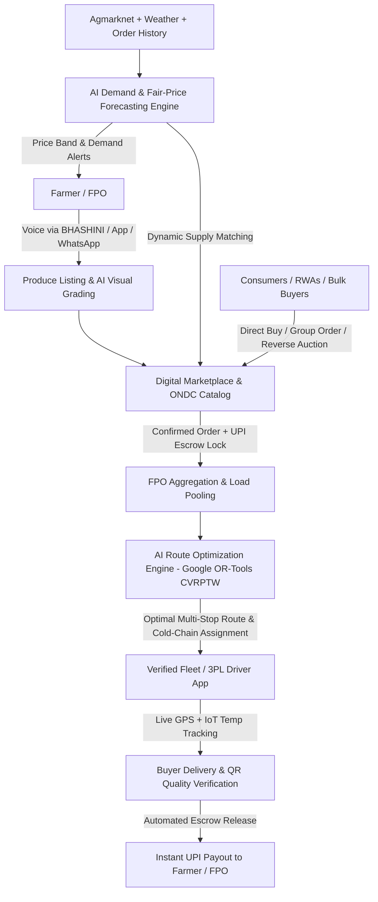

# Smart India Hackathon Workshop
# Date: 23 November 2026
## Reference Number: 26003789
## Name: Daniel S

## Problem Title
SIH 26033: Multiple intermediaries reduce farmers earnings and increase consumer prices.

## Problem Creater's Organization
Ministry of Consumer Affairs, Food & Public Distribution

## Theme
Agriculture, FoodTech & Rural Development

## Problem Description
Expected Solution: Create a digital marketplace that:

- Connects farmers/FPOs directly with consumers and bulk buyers.
- Provides logistics support.
- Uses AI for demand forecasting and route optimization.

Benefits:

- Better prices for farmers.
- Lower prices for consumers.
- Reduced supply chain inefficiencies.

**Context & Baseline Evidence:** In India, smallholders make up **86.1%** of total farm holdings with an average landholding size of **1.08 hectares** ([ICRIER / OAPEN](https://library.oapen.org/bitstream/id/5b01a982-5289-4685-99c5-15a57a22a071/978-981-33-4268-2.pdf)). Because produce typically passes through 4–6 layers of intermediaries (village aggregators, commission agents, wholesalers, sub-wholesalers, and retailers), a [Reserve Bank of India (RBI) study](https://www.rbi.org.in/scripts/BS_ViewBulletin.aspx?Id=18527) (cited in [Taylor & Francis](https://www.tandfonline.com/doi/abs/10.1080/17448727.2022.2082142)) found that the farmer's share in the consumer's rupee drops as low as **32%–68%** for horticulture (fruits and vegetables) and **40%–89%** for foodgrains and oilseeds. Meanwhile, fragmented handling and poor cold-chain coordination drive estimated annual post-harvest food losses of **₹1.53 trillion (USD 18.5 billion)** across India ([ICRIER / NABCONS 2022](https://icrier.org/publications/reducing-post-harvest-losses-in-indian-agriculture-a-case-study-of-selected-crops/)).

---

## Proposed Solution

### 1. Detailed Explanation of the Proposed Solution
We propose **KrishiSetu Direct**, an AI-powered, voice-enabled digital agricultural marketplace and pooled logistics platform that directly connects smallholder farmers and Farmer Producer Organizations (FPOs) with urban consumers, Resident Welfare Associations (RWAs), kirana stores, hotels/restaurants (HoReCa), and institutional bulk buyers.

The platform operates across four integrated pillars:

- **Direct Multi-Channel Marketplace (B2C & B2B):** Farmers and FPOs list available harvests (quantity, harvest date, quality grade, and farm-gate reserve price). Individual consumers can place hyperlocal subscription or group-buy orders, while bulk buyers can bid in transparent reverse auctions or lock in recurring supply contracts.
- **Voice-First Vernacular Onboarding:** Integrated with [Digital India BHASHINI](https://www.pib.gov.in/PressReleaseDetail.aspx?PRID=2339441&reg=17&lang=1) (supporting 23 Indian voice languages and 36 text languages), farmers can list produce, receive price advisories, and confirm pickups by speaking in their native language—removing literacy and smartphone barriers.
- **AI Demand Forecasting & Dynamic Fair-Price Engine:** Time-series forecasting models combine historical [Agmarknet 2.0](https://agmarknet.gov.in/daily-price-and-arrival-report) mandi arrivals/prices, local weather forecasts, seasonal/festival calendars, and live buyer order intent to predict 7-to-30-day regional demand and suggest a transparent fair-price band that protects farmer margins while staying below traditional retail prices.
- **Pooled Micro-Logistics & AI Route Optimization:** Instead of each small farmer hiring a costly dedicated vehicle, KrishiSetu Direct aggregates nearby farm-gate lots at FPO collection centers and uses [Google OR-Tools](https://developers.google.com/optimization/routing/vrp) to compute optimal multi-stop pickup-and-delivery "milk runs" with vehicle capacity and perishability time-window constraints, matching loads with verified local mini-trucks, reefers, and third-party logistics (3PL) partners.

### 2. How It Addresses the Problem
| Supply Chain Pain Point | How KrishiSetu Direct Solves It |
| :--- | :--- |
| **Multiple intermediary mark-ups** | Eliminates middlemen layers by connecting farmers/FPOs directly to retail consumers and bulk buyers with transparent price breakdowns. |
| **Small, fragmented farm lots** | Aggregates produce digitally across neighboring farms and [10,000+ Government-promoted FPOs](https://www.pib.gov.in/PressReleaseDetail.aspx?PRID=2294442&reg=6&lang=1) to unlock bulk transport and institutional contracts. |
| **Distress sales & price volatility** | AI demand forecasting alerts farmers and FPOs early about regional demand spikes or gluts, enabling smarter harvest timing and pre-harvest forward bookings. |
| **High transport cost & spoilage** | AI route optimization (CVRPTW) consolidates partial loads, minimizes transit time, prioritizes perishable lots, and routes shipments through nearby cold-storage hubs. |
| **Delayed cash settlements** | Automated UPI escrow releases instant digital payments to the farmer/FPO upon QR-verified quality check and handover at pickup or delivery. |

### 3. Innovation and Uniqueness of the Solution
- **Built on India's Digital Public Infrastructure (DPI):** Rather than creating another closed silo, KrishiSetu Direct is designed to plug into the [Open Network for Digital Commerce (ONDC)](https://www.pib.gov.in/PressReleasePage.aspx?PRID=2204664) (exposing FPO catalogs across multiple buyer apps), [BHASHINI](https://www.pib.gov.in/PressReleaseDetail.aspx?PRID=2339441&reg=17&lang=1) for vernacular voice AI, and UPI for instant settlement—while complementing [e-NAM](https://www.pib.gov.in/PressReleasePage.aspx?PRID=2251543) by extending digital trade directly to consumers and B2B buyers.
- **Perishability-Aware Route Optimization:** Standard delivery routers optimize only for distance; our routing engine weights each crop's remaining shelf-life and ambient temperature alongside distance and truck capacity to cut in-transit spoilage.
- **Smartphone AI Visual Grading (No Expensive Hardware):** Farmers or FPO graders capture a short photo/video of produce; an edge vision model estimates size uniformity and surface defects to assign a standardized Grade A/B/C tag, building trust for remote bulk buyers.
- **Offline-First & Assisted FPO Mode:** Works on low-bandwidth 2G/3G networks via Progressive Web App (PWA) caching, WhatsApp/IVR fallback, and an FPO coordinator dashboard for farmers without smartphones.

---

## Technical Approach

### 1. Technologies to Be Used
| Layer | Technologies & Tools | Purpose |
| :--- | :--- | :--- |
| **Frontend (Web & Mobile)** | React.js / Next.js (Buyer & FPO Web Portal), Flutter or React Native (Farmer & Driver App), PWA Offline Sync | Cross-platform, lightweight interfaces for farmers, FPOs, buyers, and fleet drivers. |
| **Voice & Vernacular AI** | [BHASHINI API](https://www.pib.gov.in/PressReleaseDetail.aspx?PRID=2339441&reg=17&lang=1) (ASR, NMT, TTS), WhatsApp Business API / IVR | Speech-to-listing and voice price alerts in regional Indian languages. |
| **Backend & APIs** | Python (FastAPI) / Node.js (Express), REST + WebSockets, ONDC Beckn Protocol Adapters | Scalable microservices for catalog, bidding, order lifecycle, and live GPS tracking. |
| **AI / ML & Optimization** | Python, Prophet / XGBoost / LightGBM (Demand & Price Forecasting), [Google OR-Tools](https://developers.google.com/optimization/routing/cvrp) (CVRP / VRPTW Route Optimization), TensorFlow Lite / MobileNetV3 (Produce Quality Grading) | Predicts crop demand/prices, optimizes pooled pickup-delivery routes, and automates visual grading. |
| **Database & Caching** | PostgreSQL with PostGIS (Geospatial queries), Redis (Real-time bidding & caching), Object Storage (S3/GCS) | Stores orders, geospatial farm/hub coordinates, and produce inspection imagery. |
| **Maps, Data & Payments** | OpenStreetMap / OSRM or Google Maps Distance Matrix API, [Agmarknet 2.0](https://agmarknet.gov.in/daily-price-and-arrival-report) & IMD Weather APIs, UPI / Razorpay Escrow | Real-time routing distances, official mandi price benchmarks, and instant escrow payouts. |
| **Optional IoT Hardware** | Low-cost BLE/LoRaWAN Temperature & Humidity Sensors, Digital Smart Weighing Scales at FPO Collection Hubs | Monitors cold-chain compliance in transit and auto-logs tamper-proof lot weights. |

### 2. Methodology and Process for Implementation &lt;b&gt;(Flow Charts/Images/ working prototype)&lt;/b&gt;

#### System Architecture & End-to-End Flow Chart

#### Implementation Methodology (4-Phase Agile Execution)
1. **Phase 1 — 36-Hour SIH Working Prototype (MVP):**
   - Build responsive Farmer/FPO, Buyer, and Logistics dashboards with role-based login.
   - Integrate a working vernacular voice-listing demo, an XGBoost/Prophet demand forecasting notebook trained on historical [Agmarknet](https://agmarknet.gov.in/daily-price-and-arrival-report) commodity datasets, and a live [Google OR-Tools](https://developers.google.com/optimization/routing/vrp) route optimizer plotting multi-stop farm-to-buyer routes on an interactive map.
   - Demonstrate simulated UPI escrow lock-and-release with QR code verification.
2. **Phase 2 — Hyperlocal FPO Pilot (Months 1–3):**
   - Partner with 3–5 active FPOs in one peri-urban horticulture cluster (e.g., tomato, onion, banana, and leafy greens) supplying nearby urban RWAs and restaurants.
   - Validate grading SOPs, pooled pickup schedules, and delivery SLAs; calibrate AI forecast accuracy against live order volume.
3. **Phase 3 — DPI & Cold-Chain Integration (Months 4–9):**
   - Complete ONDC Seller-App certification so FPO inventories surface across consumer apps nationwide.
   - Onboard regional cold-storage operators and third-party logistics fleets; add optional BLE temperature loggers for high-value perishables.
4. **Phase 4 — Multi-State Scaling (Months 10+):**
   - Expand across state agricultural corridors via collaborations with SFAC, NABARD, and state marketing boards, adding crop-input procurement and credit-scoring data exports for FPOs.

---

## Feasibility and Viability

### 1. Analysis of the Feasibility of the Idea
- **Technical Feasibility:** High. Every core component relies on mature, production-proven, open-source or public-infrastructure technologies—FastAPI, PostGIS, XGBoost/Prophet, [Google OR-Tools](https://developers.google.com/optimization/routing/vrp), [BHASHINI](https://www.pib.gov.in/PressReleaseDetail.aspx?PRID=2339441&reg=17&lang=1), and [ONDC](https://www.pib.gov.in/PressReleasePage.aspx?PRID=2204664)—minimizing R&D risk and licensing overhead.
- **Operational Feasibility:** High. Instead of onboarding millions of scattered farmers individually, the platform leverages India's existing network of **10,000 FPOs** (representing over **65 lakh farmer shareholders** under the Central Sector Scheme, per [PIB](https://www.pib.gov.in/PressReleaseDetail.aspx?PRID=2294442&reg=6&lang=1)) as physical aggregation, grading, and dispatch nodes.
- **Economic & Financial Viability:** Sustainable through an asset-light, multi-stream revenue model:
  - **0% listing commission** for small and marginal farmers to ensure rapid adoption.
  - **2%–4% platform & logistics facilitation fee** charged to B2B bulk buyers and urban consumers (still significantly cheaper than traditional multi-tier retail mark-ups).
  - **Fleet utilization margin** from pooled backhaul/milk-run logistics matching.
  - **B2B SaaS & Market Analytics** subscriptions for food processors, retail chains, and cold-chain operators.

### 2. Potential Challenges and Risks
- **Digital Literacy & Rural Connectivity Gaps:** Many smallholder farmers struggle with English-heavy mobile apps or face intermittent rural internet.
- **Quality Standardization & Buyer Disputes:** Agricultural produce is naturally variable; disagreements over freshness or weight at delivery can erode trust.
- **Logistics & Cold-Chain Fragmentation:** Unreliable rural transport availability and lack of pre-cooling facilities near farms can delay dispatches.
- **Resistance from Traditional Intermediaries:** Established mandi agents and local traders may discourage farmers from selling directly, especially when farmers rely on them for informal credit.
- **Demand & Supply Volatility:** Sudden weather events can disrupt harvest schedules or cause abrupt price swings.

### 3. Strategies for Overcoming These Challenges
| Challenge / Risk | Concrete Mitigation Strategy |
| :--- | :--- |
| **Digital Literacy & Connectivity** | Deploy voice-first regional interfaces via [BHASHINI](https://www.pib.gov.in/PressReleaseDetail.aspx?PRID=2339441&reg=17&lang=1), offline-capable PWA caching, WhatsApp/IVR ordering, and assisted onboarding through FPO coordinators. |
| **Quality Disputes & Trust** | Enforce standardized Grade A/B/C photo verification at FPO pickup, digital smart-scale receipts, QR batch traceability, and milestone-based UPI escrow protection. |
| **Logistics & Cold-Chain Gaps** | Use asset-light partnerships with local mini-truck owners, rural transport cooperatives, and existing cold-storage hubs; aggregate small lots into full-truckload milk runs via OR-Tools. |
| **Intermediary Credit Lock-in** | Partner with FPOs eligible for the government's **₹2 crore Credit Guarantee Facility** ([PIB](https://www.pib.gov.in/PressReleaseDetail.aspx?PRID=2294442&reg=6&lang=1)) and banks/NBFCs to offer instant invoice-backed working capital based on verified platform sales history. |
| **Supply/Demand Volatility** | Run rolling 7-day AI forecast updates integrated with weather alerts, offer pre-harvest subscription slots, and auto-route surplus Grade B produce to local food processors to prevent distress dumping. |

---

## Impact and Benefits

### 1. Potential Impact on the Target Audience
- **Farmers & FPOs:** Captures a substantially higher share of the consumer's rupee (improving on the [RBI baseline](https://www.rbi.org.in/scripts/BS_ViewBulletin.aspx?Id=18527) of 32%–68% for horticulture), gains predictable demand visibility before harvest, and receives instant, transparent digital payments.
- **End Consumers & RWAs:** Accesses fresher, farm-traceable produce at lower and less volatile retail prices, with transparent origin and harvest-date visibility.
- **Bulk Buyers (HoReCa, Kiranas, Food Processors):** Secures consistent, graded supply directly from producer clusters with automated invoicing, reliable ETAs, and lower procurement overhead.
- **Ministry of Consumer Affairs & Policymakers:** Gains real-time granular visibility into regional supply-demand imbalances, farm-gate-to-retail price spreads, and emerging inflation hotspots for essential commodities.

### 2. Benefits of the Solution
- **Economic Benefits:** Reduces intermediary mark-ups and deadhead logistics miles; helps curb food inflation volatility while expanding institutional market access for smallholders and FPOs.
- **Social Benefits:** Strengthens rural livelihoods and financial inclusion (over **23.55 lakh women farmers** are registered under the 10,000 FPOs scheme as of March 2026, per [PIB](https://www.pib.gov.in/PressReleaseDetail.aspx?PRID=2241415&reg=1&lang=1)), builds verifiable digital transaction histories for formal credit, and creates rural jobs in FPO grading, packaging, and local logistics.
- **Environmental Benefits:** Cuts perishable food waste—addressing India's **₹1.53 trillion** annual post-harvest loss challenge ([ICRIER / NABCONS](https://icrier.org/publications/reducing-post-harvest-losses-in-indian-agriculture-a-case-study-of-selected-crops/))—and lowers transport fuel consumption and carbon emissions through AI-optimized consolidated routing.

---

## Research and References

1. **Reserve Bank of India (RBI) Bulletin (Oct 2019) — *Supply Chain Dynamics and Food Inflation in India*:** Primary survey across 14 crops quantifying the farmer's share in the consumer's rupee, mark-up drivers, and higher intermediary margins in perishables. [View RBI Bulletin](https://www.rbi.org.in/scripts/BS_ViewBulletin.aspx?Id=18527) | [Secondary Citation (Taylor & Francis, 2022)](https://www.tandfonline.com/doi/abs/10.1080/17448727.2022.2082142)
2. **NABCONS (2022) & ICRIER Policy Brief — *Reducing Post-Harvest Losses in Indian Agriculture*:** Ministry of Food Processing Industries (MoFPI)-commissioned study estimating ₹1.53 trillion (USD 18.5 billion) in annual post-harvest food losses across India. [ICRIER Policy Brief](https://icrier.org/publications/reducing-post-harvest-losses-in-indian-agriculture-a-case-study-of-selected-crops/) | [PIB Summary (Dec 2025)](https://www.pib.gov.in/PressReleasePage.aspx?PRID=2198688)
3. **Ministry of Agriculture & Farmers Welfare — *10,000 FPOs Central Sector Scheme*:** Official data on 10,000 FPOs collectivizing 65+ lakh farmer shareholders, equity grants, and ₹2 crore credit guarantees. [PIB Release (Aug 2026)](https://www.pib.gov.in/PressReleaseDetail.aspx?PRID=2294442&reg=6&lang=1) | [Women Farmers in FPOs (PIB, Mar 2026)](https://www.pib.gov.in/PressReleaseDetail.aspx?PRID=2241415&reg=1&lang=1)
4. **National Agriculture Market (e-NAM):** Official milestones showing 1,656 integrated mandis, 1.80+ crore farmers, 4,724 FPOs, and ₹4.84 lakh crore cumulative trade across 247 commodities. [PIB Release (Apr 2026)](https://www.pib.gov.in/PressReleasePage.aspx?PRID=2251543)
5. **Open Network for Digital Commerce (ONDC):** Framework enabling FPOs, SHGs, and small sellers to reach buyers across interoperable digital commerce apps without platform lock-in. [PIB Release (Dec 2025)](https://www.pib.gov.in/PressReleasePage.aspx?PRID=2204664)
6. **Digital India BHASHINI:** National multilingual voice-first AI platform supporting 36 Indian text languages and 23 voice languages for inclusive farmer onboarding. [PIB Release (Nov 2026)](https://www.pib.gov.in/PressReleaseDetail.aspx?PRID=2339441&reg=17&lang=1)
7. **Agmarknet 2.0 (Directorate of Marketing & Inspection, MoA&FW):** Official daily mandi price and arrival datasets for training AI demand and fair-price models. [Agmarknet Daily Price & Arrival Report](https://agmarknet.gov.in/daily-price-and-arrival-report)
8. **Google OR-Tools — Vehicle Routing Problem (VRP / CVRP):** Open-source optimization framework for multi-stop pickup-and-delivery routing with vehicle capacity and time-window constraints. [OR-Tools VRP Documentation](https://developers.google.com/optimization/routing/vrp) | [Capacitated VRP Guide](https://developers.google.com/optimization/routing/cvrp)
9. **ICRIER / Springer Open (OAPEN) — *Ensuring Farmers' Income & Agricultural Value Chains*:** Baseline data on Indian smallholder farm structure (86.1% smallholders, 1.08 ha average holding) and horticulture market linkage challenges. [OAPEN Publication PDF](https://library.oapen.org/bitstream/id/5b01a982-5289-4685-99c5-15a57a22a071/978-981-33-4268-2.pdf)
